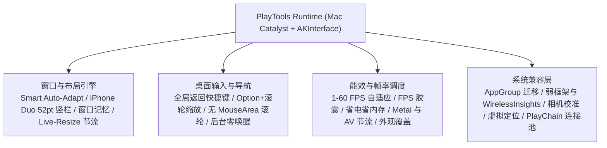

# PlayTools (Personal Compatibility & Efficiency Fork)

PlayTools 是随 [PlayCover](https://github.com/Rengwang/PlayCover) 注入到 iOS 应用内的运行时兼容框架（由 iOS 切片、Mac Catalyst 切片与 `AKInterface.bundle` AppKit 桥接组成）。本仓库（[`Rengwang/PlayTools`](https://github.com/Rengwang/PlayTools)）基于上游 [`PlayCover/PlayTools`](https://github.com/PlayCover/PlayTools)（`master`）维护，重点增强桌面窗口适应、能效调度与 Catalyst 系统兼容性。

> 完整的双仓库架构图、界面截图与性能基线请参阅 [`Rengwang/PlayCover` 主页](https://github.com/Rengwang/PlayCover/blob/develop/README.md) 及 [维护手册](https://github.com/Rengwang/PlayCover/blob/develop/docs/MAINTENANCE.md)。

---

## 相比原版的主要增强

### 核心模块对照

| 模块 | 职责与相比原版的改进 |
| --- | --- |
| [PlayScreen.swift](PlayTools/PlayScreen.swift) | **Smart Auto-Adapt** 自适应与等比画布自动切换、非全屏子视图膨胀保护、iPad 兼容应用窄屏防误落 9:16、窗口位置持久化、`CFRunLoopObserver` 自适应 Live-Resize 帧节奏节流 |
| [DuoVerticalBarCompatibility.m](PlayTools/DuoVerticalBarCompatibility.m) | **iPhone Duo** 可切换 52pt 右侧悬浮竖栏（多子视图 Tab 重定位、空白占位检测、透明 Alpha 采样）与跨应用的 **全局返回 / 回首页** 快捷键及标题栏按钮 |
| [OptionScrollZoomController.swift](PlayTools/Controls/OptionScrollZoomController.swift) | 以光标为中心的 **Option + 滚轮** 双指捏合缩放手势合成 |
| [PlayEfficiencyHooks.h](PlayTools/PlayEfficiencyHooks.h) / [PlayEfficiencyHooks.m](PlayTools/PlayEfficiencyHooks.m) | **省电/省内存模式**、**`1–60 FPS` iOS 语义自适应限帧**、**左上角轻量化 FPS 悬浮窗**、`CAMetalLayer` / `AVPlayerItem` 节流、窗口遮挡媒体暂停与暗黑模式不透明材质回退 |
| [PlayLoader.m](PlayTools/PlayLoader.m) | App Group 无空格路径迁移、`iOS 26/27` 自定义 TabBar 浮胶囊隐藏、弱链接 iOS 框架可用性守护、UE `getlogin_r` 死锁与退出超时保护、`MSCWebView` 鼠标转触控、`CloudKit` 存根、开屏与 SDK 风险横幅中性化 |
| [CameraCompatibility.m](PlayTools/CameraCompatibility.m) / [LocationCompatibility.m](PlayTools/LocationCompatibility.m) | Catalyst 后摄回退与 `RotationCoordinator` 水平角校准、前后摄预览独立镜像；线程安全 `CLLocationManager` 模拟定位 |
| [OneNoteSceneCompatibility.m](PlayTools/OneNoteSceneCompatibility.m) / [CTPocketOutputCompatibility.mm](PlayTools/CTPocketOutputCompatibility.mm) / [Compatibility/](Compatibility/) | OneNote 启动开屏场景衔接、退出期 C++ 标准流缓冲恢复、`MarketplaceKit`（`AppDistributor.other`）与 `WirelessInsights` 弱连接兼容存根 |
| [PlayedApple.swift](PlayTools/MysticRunes/PlayedApple.swift) / [PlayedAppleDB.swift](PlayTools/MysticRunes/PlayedAppleDB.swift) | `PlayChain` 全属性精确匹配、空数据保留、精准删除保护与 SQLite 连接池化 |
| [PlayInput.swift](PlayTools/Controls/PlayInput.swift) / [DiscordIPC.swift](PlayTools/DiscordActivity/DiscordIPC.swift) | 失焦/隐藏后停止摇杆后台轮询并释放滑动计时器，消除 Discord IPC 空转唤醒与线程泄漏 |

---

## 自动化测试套件（`Tests/`）

所有核心几何数学逻辑、输入生命周期与构建产物不变式均附带自动化回归检查（最近一轮全量运行 **154 passed / 0 failed**）：

- `python3 Tests/check-compat-invariants.py`：源码与已安装构建产物全量不变式检查
- `python3 Tests/check-input-lifecycle.py`：手柄/触摸状态机、后台零分发及滑动计时器对象释放回归
- `python3 Tests/check-option-scroll-zoom.py`：Option + 滚轮缩放手势回归
- `python3 Tests/check-msc-mouse-bridge.py`：WebKit 鼠标转触控与指针去重回归
- `python3 Tests/check-duo-vertical-bar.py` & `python3 Tests/check-global-back.py`：Duo 侧栏布局与全局返回手势回归
- `python3 Tests/check-launch-crash-guards.py` & `python3 Tests/check-wireless-insights-compat.py`：启动防崩守护与 `WirelessInsights` 兼容存根回归

---

## 构建与社区 PR 致谢

- 双仓库构建入口与安装校验请参阅 [`PlayCover/Tools/Workspace/sync_upstream.sh`](https://github.com/Rengwang/PlayCover/blob/develop/Tools/Workspace/sync_upstream.sh)。
- 感谢上游 [`PlayCover/PlayTools`](https://github.com/PlayCover/PlayTools) 及本分支同步合并的社区 PR 作者：`#229` (`hedssaz`)、`#241` (`BettTer`)、`#249` (`neverlock`)、`#251` (`jingerpie`)、`#263` (`kts-kris`)。
